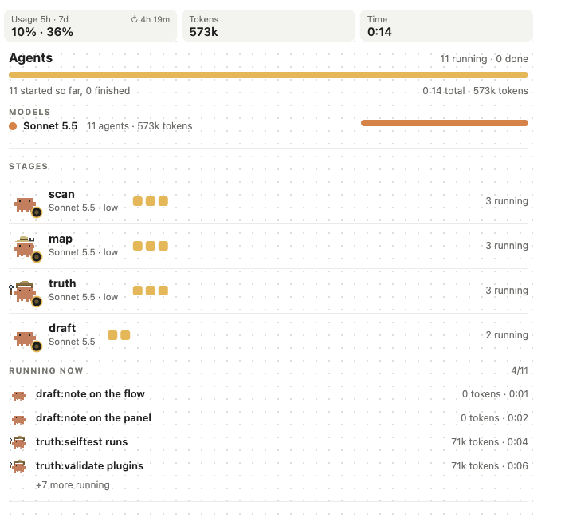
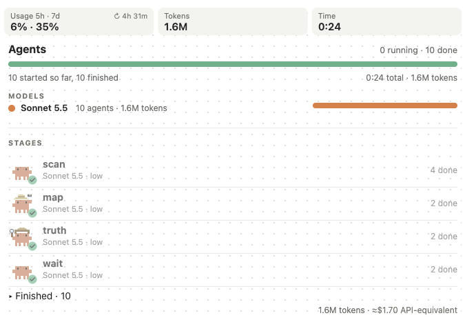

# duo: see every AI agent Claude spawns for you

<p align="center">
  
</p>

On a big job, Claude Code starts helper agents by itself. By default you can't see what they are doing, which model each one runs on, or what they cost you. **duo shows every one of them live**: its task, model, effort, steps and tokens, plus how much of your usage limit you have used. You don't create or steer the agents; you watch.

*An **agent** is a helper Claude starts for one task. The **model** (Haiku, Sonnet or Opus) is the brain it runs on, and **effort** is how hard it thinks. A **token** is a small piece of text the model reads or writes; your limit is counted in them.*

| | |
| --- | --- |
| **What it is** | A panel and a bar for Claude Code on a Pro or Max plan, plus a small flow that picks a model and effort for each agent. |
| **What it costs** | It may use **more** of your limit than plain Sonnet. In our first runs a worker used about 76k tokens and a checker about 14k, even for a one-file change (unmeasured beyond that: three tiny tasks on one machine, not a benchmark). Cost compared with plain Sonnet is **unmeasured**. Try it on one task first; removing it is two commands. |
| **Who it is for** | People who want to see what their agents are doing, and are fine paying for that visibility. |

> **A fork of the amazing [claude-kit](https://github.com/JohnnyVizz/claude-kit) by [JohnnyVizz](https://github.com/JohnnyVizz)**, the home of savvy-flow, savvy-progress and session-band. duo is built on his flow, panel and band; we adapted it for Pro and Max and renamed parts of it. [What is his and what is new](#claude-kit-and-duo).

## Install

```
/plugin marketplace add googlarz/duo
/plugin install duo@duo
/plugin install duo-progress@duo
```

Restart Claude Code, then give it a task:

```
/duo:duo add rate limiting to the upload endpoint and cover it with tests
```

`duo` is the flow and `duo-progress` is the panel; you need both to see your agents. That is all that is required. duo plans, Claude creates the agents, and you watch them in the panel and in the bar above the prompt. At the end you get a short report with what changed, what was verified, and how much of your limit the run used.

## What you see

- **A live panel** with every agent: task, **model and effort**, progress, steps (open *Details* under a task), context, tokens, an estimated cost and time. With many agents at once (more than 8) it groups them by stage and shows the model mix.
- **Your usage:** the first tile shows how much of your 5-hour and weekly window you have used, and when the 5-hour one resets ("↻ 4h 36m"; hover for both), read from Claude Code itself (no setup). It stays at the top of the grouped view too. When a run ends it says how much that run used.
- **Who needs a look.** An agent that fails, or that shows no sign of life for three minutes, is flagged (asleep crab, "stalled 4m") and, once there are many agents, pinned in a **Needs attention** block at the top of the grouped view with what it was doing. The bar above the prompt shows a count (⚠ 2).
- **What happened when it is over.** The Finished list shows a PASS or FAIL badge for each checker and the start of what every agent answered, a `Details` switch opens the rest, and one line above it says how many PASS and FAIL and what the run used of your limit.
- **What each agent is doing now** ("editing cart.py", "running: python3"), what it returned, whether the checker said PASS or FAIL, which files it edited, and, when the orchestrator says so, why it picked that tier.
- **A bar above the prompt** that shows the flow's progress and your usage, and appears together with the plan. It also follows agents Claude starts outside a duo flow.
- **A run receipt:** `/duo:receipt` prints a markdown receipt of the run (every agent, model, steps, tokens, estimated cost, verdicts, files), built by the panel from what the agents did, not written by a model. Paste it into a pull request or keep it; the panel keeps the last ten finished runs.
- **Something Claude Code does not show by default.** Claude Code has `/agents` (which lists agent definitions) and `/usage` (which shows your totals). duo adds the live, per-run view of who is working on what, and on which model.

## When to use it

Use it on multi-step work where you want to follow what happens, for example "add rate limiting to the upload endpoint and cover it with tests". Claude splits it into a few tasks, Sonnet workers do them, a fresh checker verifies, and you can see each step.

Skip it for a one-file fix: the agents add overhead and plain Claude is simpler.

## What is tested

In our own runs in the desktop app, duo works from the task to the report: Sonnet workers, a fresh checker, the panel with model, effort, steps and usage, and the bar above the prompt. **Not tested live yet:** the Opus plan check and review, the 80% and 95% limit behaviour, the grouped view with a real fan-out, and the newest additions (the Needs attention block, the one-line status, the run receipt and the "why" line), which have unit tests but have not been seen in a real run.

<details>
<summary><b>The full list</b></summary>

Tested live (desktop app): the whole `/duo:duo` flow, the panel (model, effort, steps, usage tile), the bar above the prompt, the per-run usage line, the history file, `/duo:setup`. In a terminal the status-line helper wrote the usage file. Automated tests: 119 for the panel (`cd plugins/duo-progress && claude plugin test .`, including the agent lifecycle, the receipt and contrast checks) and 16 for the helper scripts (`plugins/duo/scripts/selftest.sh`); a GitHub Actions workflow runs both and the plugin validation on every push (green on the last two pushes).

Not tested live: the Opus plan check and review (no run has needed them), the 80% and 95% limit behaviour, the hook for a real limit, the cost forecast beyond tiny tasks, learning from past runs, resuming after a reset, a bare `/duo` (use `/duo:duo`), the grouped view with a real fan-out of more than 8 agents, and narrow terminals. The panel uses Claude Code's early-access hooks and may change between releases.

</details>

## claude-kit and duo

duo is a fork of **claude-kit** by JohnnyVizz ([JohnnyVizz/claude-kit](https://github.com/JohnnyVizz/claude-kit)), "public Claude Code skills and mods" in his words. claude-kit has three plugins: **savvy-flow** (an orchestrated flow with tiered workers), **savvy-progress** (a progress bar and an agents panel) and **session-band**. They work on any plan; savvy-flow's default workers are Opus and Fable, which spend a subscription limit faster. duo keeps the same ideas and retunes them for Pro and Max.

| In claude-kit | In duo | What is new in duo |
| --- | --- | --- |
| `savvy-flow` (the orchestrated flow, Opus and Fable workers) | [`duo-flow`](plugins/duo-flow), the same flow renamed | nothing; it stays as the original |
| `savvy-progress` (the agents panel) | [`duo-progress`](plugins/duo-progress), renamed and extended | usage tile and per-run usage, grouped view for big fan-outs, more costumes, a bar with usage |
| `session-band` | [`session-band`](plugins/session-band), unchanged | |
| | [`duo`](plugins/duo) | the Sonnet-based flow: nine agents (workers by effort, an advisor, a reviewer, a verifier), a usage guard, a run history |

**Which one to use:** the original claude-kit (savvy-flow) if you want Opus or Fable workers; it works on any plan, including Pro. duo if you want Sonnet workers with Opus only as a plan check and a review, tuned for how fast a Pro or Max limit drains. To install the original (these are the steps in his README): `/plugin marketplace add johnnyvizz/claude-kit`, then `/plugin install savvy-flow@claude-kit` and, for the panel, `/plugin install savvy-progress@claude-kit`. You can have both: the commands differ (`/savvy-flow:savvy-flow` there, `/duo-flow:duo-flow` for the same flow here, `/duo:duo` for the Sonnet flow), and `duo-progress` shows agents from either. Install only one panel plugin, not both `savvy-progress` and `duo-progress`.

## Optional extras

**Usage guard (`/duo:setup`).** Run it once if you want duo to slow down near your limit: at 80% it stops using the Opus plan check and caps workers at medium, at 95% it stops starting new work. It asks first, then adds a small helper to your status line (your own status line keeps working) by changing `statusLine` in `~/.claude/settings.json` and keeping a backup as `settings.json.bak-duo`. Designed, not yet tested on a real limit. Details: [usage-limits guide](plugins/duo/docs/usage-limits.md).

**Your own rules in `CLAUDE.md`.** duo's defaults are plain instructions, so you change them the way you change any Claude Code behaviour: with rules in `CLAUDE.md`, global (`~/.claude/CLAUDE.md`) or per project. For example:

```markdown
## duo
- Opus only for the plan check and the review, never as a worker.
- Cap effort at medium unless I say otherwise.
- Always run the final review, even on small jobs.
```

The one thing a rule cannot quietly switch off is the safety stop: Opus as a worker still needs your explicit yes.

**What duo keeps on your machine.** `~/.claude/duo-history.jsonl` (one line per run: size, tiers, how much of your limit it used; used for a forecast after a few runs), the panel's last ten run receipts (in the plugin's own store under your Claude Code config folder), and with `/duo:setup` also `~/.claude/duo-usage.json`. duo's own scripts make no network calls (the agents themselves use Claude Code's normal tools, such as the shell, and the advisor can fetch web pages).

**session-band.** A band above the prompt with turn, speed, cost, cache countdown and context. Optional: `/plugin install session-band@duo`.

## Requirements and uninstall

A recent Claude Code (we run 2.1.314) on a Pro or Max plan; the usage reading needs a subscription. The panel works in the desktop app.

To remove duo:

```
/plugin uninstall duo@duo
/plugin uninstall duo-progress@duo
```

Only if you ran `/duo:setup` (it is what creates the backup), put your status line back: change `statusLine` in `~/.claude/settings.json` to what it was (the backup `~/.claude/settings.json.bak-duo` shows the old value; copying the whole file back also undoes any settings you changed since), and delete `~/.claude/duo-usage-cache.sh`, `duo-usage.json`, `duo-limit-hit.json` and `duo-history.jsonl` if you like.

## Questions and words

**Do I have to create or steer anything?** No. Claude creates the agents and picks models; you watch. Shape duo only with `CLAUDE.md` rules if you want.

**What is an agent? A model? Effort?** An *agent* is a helper Claude starts for one task. The *model* (Haiku, Sonnet, Opus) is the brain it runs on. *Effort* (low to max) is how hard it thinks. duo shows all three for every agent.

**What is the "Opus gate"?** Opus is only asked to check the plan and to review the finished work; Sonnet does the building. Small jobs skip it.

**Will it use more of my limit?** Possibly, see the box at the top. Each run reports how much it used, so you can judge for yourself.

**Does it change my files?** The builder agents edit your project, as in any Claude Code run. The plan checker (the advisor), reviewer and verifier have no Edit or Write tools (they keep a shell for running checks and are told not to change files).

**Something looks off.** Please [open an issue](https://github.com/googlarz/duo/issues) with what you saw.

## The crabs

Every agent in the panel is a small animated pixel crab, and its costume follows the job: a detective for verification, a robot for building, a doctor for fixes, a rocket for deploys, ninjas for speed, cold and hot fixes, and more (29 costumes; unknown jobs get the plain crab). They are decoration, and we like them. [See them all](assets/duo-crabs.svg).

<details>
<summary><b>How the flow works</b></summary>

<p align="center">
  
</p>

<p align="center">
  
</p>

Sonnet does the volume and Opus is a gate. Up to 2 tasks skip both Opus calls; 3 to 4 low-risk tasks skip the plan check and keep one final review. Two attempts per task, a checker that did not write the code, and Opus as a worker only if you say yes. The same panel after the agents finished (a real run, with the Stages block that big runs get; the screenshot at the top shows eleven agents running):

<p align="center">
  
</p>

| Effort | Used for |
| --- | --- |
| `low` | renames, boilerplate, config, small fixes |
| `medium` | standard features, bugs with a known cause |
| `high` | delicate work: refactors, many edge cases (default ceiling) |
| `xhigh` | unfamiliar code, unclear root cause (after a failure or when explicit) |
| `max` | very complex logic, or a bug that survived xhigh |

Environment overrides win over duo: if you set `CLAUDE_CODE_SUBAGENT_MODEL` (especially with `_FORCE`) or `CLAUDE_CODE_EFFORT_LEVEL`, Claude Code applies them over duo's per-stage models and effort. Full rules: [SKILL.md](plugins/duo/skills/duo/SKILL.md). Whether duo costs more or less than plain Sonnet is what [the benchmark](benchmark/README.md) is meant to answer; [the first small run](benchmark/mini-run.md) only checks the plumbing.

</details>

<details>
<summary><b>What is in this repo</b></summary>

| Plugin | What it is |
| --- | --- |
| [duo](plugins/duo) | The flow and the nine agents: model and effort per stage, a usage guard, a run history |
| [duo-progress](plugins/duo-progress) | The panel and the bar: every agent with model, steps and usage |
| [duo-flow](plugins/duo-flow) | claude-kit's savvy-flow (Opus and Fable workers), renamed |
| [session-band](plugins/session-band) | Band above the prompt: turn, speed, cost, cache countdown, context |

Develop: `scripts/check-versions.sh` before pushing (a plugin change needs a version bump, or `update` will not see it), `plugins/duo/scripts/selftest.sh`, `cd plugins/duo-progress && claude plugin test .`, `claude plugin validate .`, and `plugins/duo/scripts/gen-agents.sh` (regenerates the six worker agents from one shared body).

</details>

---

## Credits

duo stands on the work of **[JohnnyVizz](https://github.com/JohnnyVizz)** and his [claude-kit](https://github.com/JohnnyVizz/claude-kit): the orchestration flow (savvy-flow, now `duo-flow`), the tiered-worker idea, the agents panel (savvy-progress, now `duo-progress`) and session-band all come from it. This repository began as a fork of it, keeps his code and licence, and adapts the idea to Pro and Max plans. Thank you.

MIT licence, see [LICENSE](LICENSE). Original work © 2026 JohnnyVizz (written "johnnyvizz" in the licence file); duo additions © 2026 googlarz.
