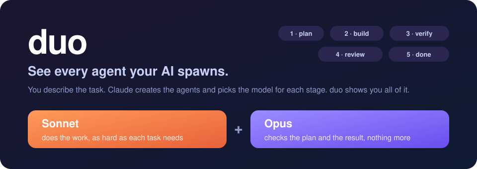
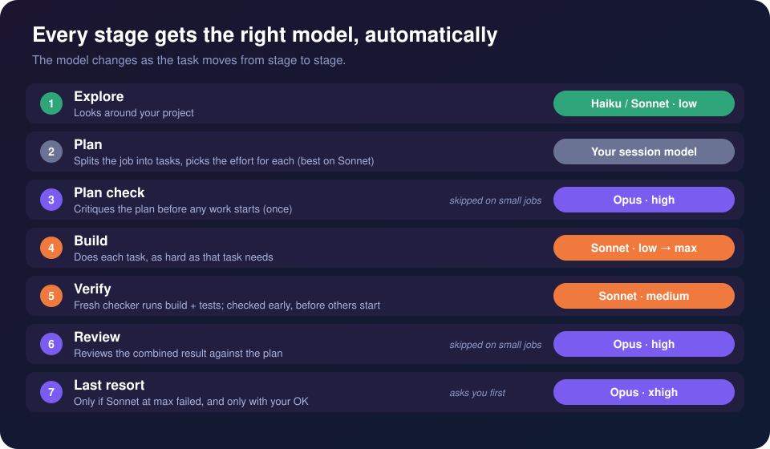
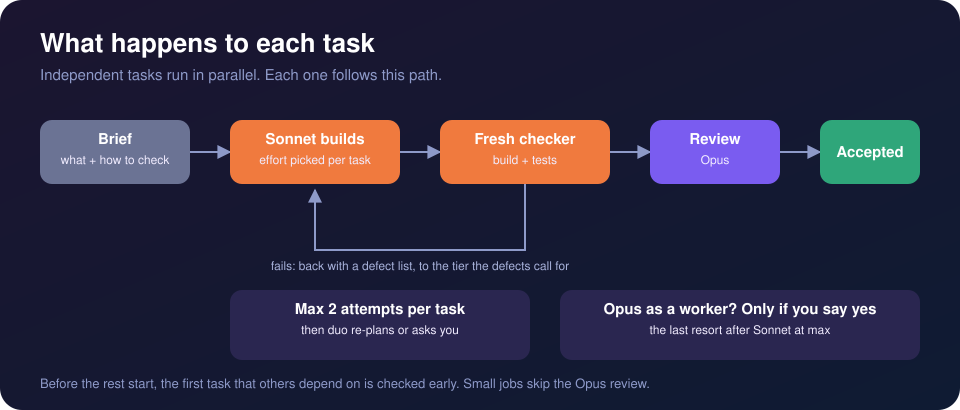
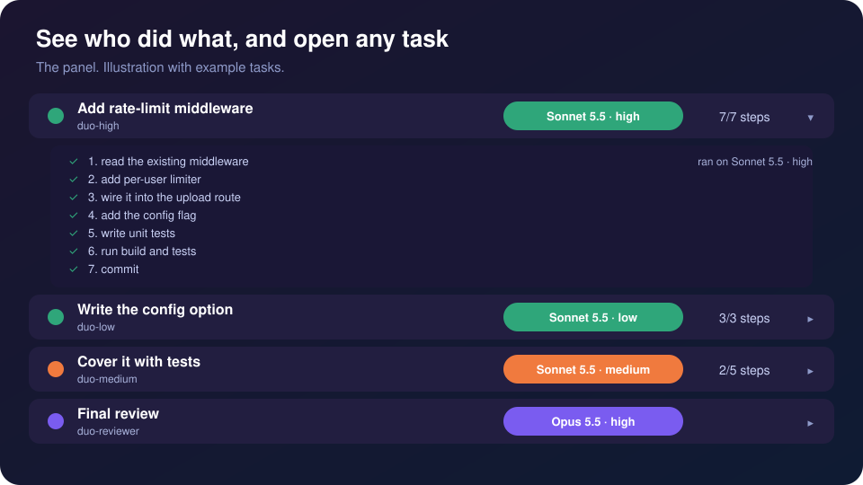
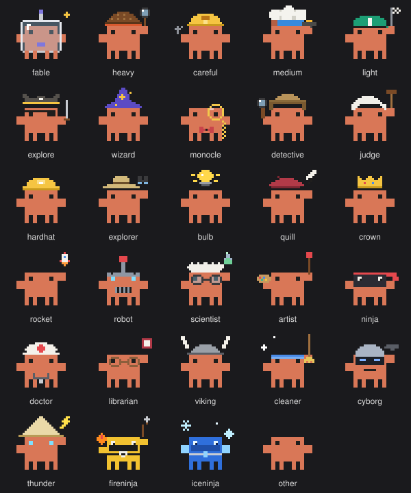

<p align="center">
  
</p>

<p align="center">
  <b>See every AI agent Claude spawns for you: what it does, and on which model.</b><br>
  Built for Claude Pro / Max, where every agent spends your usage limit.
</p>

---

## The problem

When you give Claude Code a big job, it doesn't work alone. It **creates agents on its own**: one to explore, several to build, one to test, one to review. You don't write them and you don't pick them. By default you also can't see them: which model each one runs on, what it is doing, how far along it is, what it costs.

On a subscription that's your usage limit draining in a place you can't look.

## What duo gives you

You describe the task. The AI creates the agents and picks the model for each stage. duo works with zero setup, and you can shape it with ordinary rules in your `CLAUDE.md`. It adds the two things that were missing:

| | |
| --- | --- |
| 👁 **Visibility** | A live panel with **every agent**: its task, the **model and effort** it runs on, its steps, progress, tokens, cost and time. Open any task to see its steps. With big fan-outs of many agents it groups them by stage and shows the model mix, so it stays readable. Each stage gets its own animated pixel crab in a costume. |
| 🧠 **The right model, automatically** | The AI picks the model for each stage and the effort for each task by itself, within built-in guardrails (an Opus budget, a cap on retries, a check when your limit runs low). Works out of the box; shape it with your own rules in `CLAUDE.md` if you want (see below). |

### The right model at every stage, chosen automatically

<p align="center">
  
</p>

Sonnet does the volume. Opus is a gate (a plan check and a review), not a worker. Small jobs skip the Opus stages.

### What happens to every task

<p align="center">
  
</p>

The agents run in parallel where they can, within guardrails: **two attempts per task**, a fresh checker that did not write the code, and **Opus as a worker only if you say yes** (the one thing it asks you). Design decisions (anything users see) stay with you; agents don't invent UI.

### Visibility: open any agent

<p align="center">
  
</p>

Every task row shows the model and effort that ran it. When many agents run at once (more than 8), the panel switches to a grouped view: a summary, the model mix, one row per stage, only the few running agents in view, and the finished ones folded away. Press Details under a task to see the steps the agent planned and which are done. *(Illustration with example tasks.)*

### Meet the crabs

Every agent is a small animated pixel crab, and its costume tells you the job. The panel picks the costume from the stage name: a detective for `truth` and `verify`, a robot for `build`, a rocket for `deploy`, a doctor for `fix`, a ninja for `perf`, a librarian for `docs`, a cyborg cop for `enforce`, a fire ninja for `hotfix`, an ice ninja for `cache`, and more. Unknown stage names get the plain crab.

<p align="center">
  
</p>

## Try it

Install duo and the panel:

```
/plugin marketplace add googlarz/duo
/plugin install duo@duo
/plugin install duo-progress@duo
```

Restart Claude Code, then give it a task:

```
/duo:duo add rate limiting to the upload endpoint and cover it with tests
```

duo plans, the AI spawns the agents and runs them, and at the end you get a report: what changed, what was verified, what was left out, and which models did the work. If the panel doesn't appear, load it by hand: `claude --plugin-dir ~/duo/plugins/duo-progress`.

> Shorter command: try plain `/duo <task>`. If your version doesn't accept it, copy the skill once:
> `git clone https://github.com/googlarz/duo.git ~/duo && cp -R ~/duo/plugins/duo/skills/duo ~/.claude/skills/`

## Built-in guardrails for your usage limit (automatic)

- **Opus budget:** one plan check and up to two reviews per run. Opus as a worker only with your consent.
- **Effort ceiling:** tasks run at `high` at most; `xhigh` and `max` only after a failed attempt or when the cause is unclear.
- **Limit-aware** *(optional, 2 min setup)*: at 80% used, duo skips the plan check and early review and caps workers at `medium`. At 95% it stops starting new work and reports where it stands, so you can continue after the reset. Setup: **[usage-limits guide](plugins/duo/docs/usage-limits.md)** (Pro/Max only; the plan reports usage only there).
- **Your session model:** run duo from a Sonnet session. duo can't see which model your session runs, so tell it if it's Opus (then it reviews itself instead of calling a second Opus) or Haiku (then the plan check is mandatory).

## Make it yours: rules in CLAUDE.md

duo's defaults are plain instructions, so you change them the way you change any Claude Code behaviour: with rules in `CLAUDE.md`, either **global** (`~/.claude/CLAUDE.md`, all projects) or **per project** (`CLAUDE.md` in the repo). The orchestrator reads them like any session does, and your rules beat duo's defaults. For example:

```markdown
## duo
- Opus only for the plan check and the review, never as a worker.
- Cap effort at medium unless I say otherwise.
- Always run the final review, even on small jobs.
- Stop starting new tasks at 90% of my limit.
```

The one thing a rule can't quietly switch off is the safety stop: Opus as a worker still needs your explicit yes (a rule that pre-approves it counts as a yes).

Also good to know:
- **Different model or effort for a role?** Each role is an agent file (`plugins/duo/agents/duo-*.md`, generated by `scripts/gen-agents.sh`). Edit `model:` / `effort:` in your copy.
- **Environment overrides win over duo.** If you have set `CLAUDE_CODE_SUBAGENT_MODEL` (especially with `_FORCE`) or `CLAUDE_CODE_EFFORT_LEVEL`, Claude Code applies them over duo's per-stage models and effort (per its docs). Unset them for duo to work as designed.
- **Claude Code's own `/usage`** also breaks your usage down by subagent, a handy cross-check for the panel.

## Questions

**Do I have to create, configure or steer anything?** No. Claude creates the agents and chooses the models; you just watch. If you do want a say, use rules in `CLAUDE.md` (next section). duo ships ready-made roles (`duo-low` … `duo-max`, `duo-verifier`, `duo-advisor`, `duo-reviewer`, `duo-opus`), and the AI picks the right ones for each task.

**Will it burn my Opus limit?** That's what the rules prevent: one plan check and up to two reviews per run, none on small jobs.

**Is it worth it for a small fix?** No. Use plain Sonnet or the built-in `opusplan`. duo pays off on multi-step work with several agents.

**What if I hit my limit mid-run?** With the limit helper set up, duo stops before the wall and reports which tasks are done and which are waiting. Say "continue" after the reset (in interactive sessions Claude Code can also wait for the reset and continue on its own, per its docs).

**Does it change my files without asking?** The builder agents edit your project, as in any Claude Code run, and you see every change. The plan checker, reviewer and verifier have no Edit or Write tools (they keep a shell to run checks and are told not to change files).

**Which Claude Code version?** Recent. duo uses subagents with per-agent model and effort. Effort `low` to `max` is available on Sonnet 5.5; on older Sonnets an unsupported level falls back to the closest lower one.

<details>
<summary><b>Effort per task</b></summary>

| Effort | Used for |
| --- | --- |
| `low` | renames, boilerplate, config, small fixes |
| `medium` | standard features, bugs with a known cause |
| `high` | delicate work: refactors, many edge cases (default ceiling) |
| `xhigh` | unfamiliar code, unclear root cause (after a failure or when explicit) |
| `max` | very complex logic, or a bug that survived xhigh |

Agents behind the stages: Explore subagent, the orchestrator (your session), `duo-advisor` (plan check), `duo-low` … `duo-max` (build), `duo-verifier`, `duo-reviewer`, `duo-opus` (last resort). Full rules: [SKILL.md](plugins/duo/skills/duo/SKILL.md).

</details>

<details>
<summary><b>Honest status</b></summary>

Verified: all plugins pass `claude plugin validate`; the panel's tests pass; the helper scripts ran against sample input; the effort levels and agent settings duo relies on were checked against the Claude Code docs.

Not yet verified, because it needs a live session: the statusline helper in daily use, the rate-limit hook firing on a real limit, how the panel's details and grouped views look in the real app, and whether a bare `/duo` resolves on your version. The panel is built on Claude Code's early-access hooks and may change between releases. If something looks off, please open an issue with what you saw.

</details>

<details>
<summary><b>What's in this repo</b></summary>

| Plugin | What it is |
| --- | --- |
| [duo](plugins/duo) | The rules and the agents: model per stage, effort per task, Opus budget, limit awareness |
| [duo-progress](plugins/duo-progress) | The panel: every agent with its model, steps, cost; understands the duo tiers |
| [savvy-flow](plugins/savvy-flow) | The original flow by JohnnyVizz (tiered Opus/Fable workers), for API-style budgets |
| [session-band](plugins/session-band) | Band above the prompt: turn, speed, cost, cache countdown, context |

Develop: `claude plugin validate .` · `cd plugins/duo-progress && claude plugin test .` · `plugins/duo/scripts/gen-agents.sh` (regenerates duo's six worker agents from one shared body).

</details>

---

## Credits

`duo` stands on the work of **[JohnnyVizz](https://github.com/JohnnyVizz)**. The savvy-flow orchestration pattern, the tiered-worker idea, the savvy-progress panel (now `duo-progress`) and session-band all come from [JohnnyVizz/claude-kit](https://github.com/JohnnyVizz/claude-kit). This repo started as a fork of it, keeps that code and its licence, and adapts the idea to subscription budgets. Thank you.

MIT licence, see [LICENSE](LICENSE). Original work © 2026 johnnyvizz; duo additions © 2026 googlarz.
