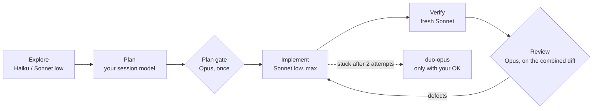

# duo

**Sonnet works. Opus checks. Your usage limit lasts.**

`duo` is an orchestrated delivery flow for [Claude Code](https://claude.com/claude-code) built for **Claude subscriptions (Pro / Max)**, where the budget is not dollars but your 5-hour and weekly usage limit. Most orchestration flows put the most expensive model on every task. `duo` does the opposite: a Sonnet does the volume, and Opus is called in only at the moments where a second, stronger opinion is worth its price.

```
/duo:duo add rate limiting to the upload endpoint and cover it with tests
```

> Built on [savvy-flow](https://github.com/JohnnyVizz/claude-kit) by [JohnnyVizz](https://github.com/JohnnyVizz). This repo is a fork that keeps savvy-flow, savvy-progress and session-band intact and adds `duo`, the subscription flavour. See [Credits](#credits).

## Why duo

| On a subscription you want... | duo does this |
| --- | --- |
| Sonnet for the bulk of the work | Workers are Sonnet at effort `low`, `medium`, `high`, `xhigh` or `max`, chosen per task |
| Opus where it pays off | Opus is a gate, not a worker: one plan critique, at most two reviews, and a last-resort escalation |
| The right model for each stage | Explore, plan, implement, verify and review each run on the model that fits the stage |
| No self-grading | Tests run in a fresh verifier agent; the review is by a different model than the one that wrote the code |
| No surprise limit walls | The flow reads your usage windows and downshifts at 80%, stops starting tasks at 95% |
| To see what happened | With the optional panel you see every task, its model, effort, steps and cost |

## How it works



| Stage | Agent | Model / effort |
| --- | --- | --- |
| Explore | Explore subagent | Haiku or Sonnet low |
| Plan | the orchestrator | your session model |
| Plan gate (once) | `duo-advisor` | Opus high, no Edit/Write |
| Implement | `duo-low` … `duo-max` | Sonnet, effort by difficulty |
| Verify | `duo-verifier` | Sonnet medium, fresh agent, no Edit/Write |
| Review | `duo-reviewer` | Opus high, no Edit/Write |
| Last resort | `duo-opus` | Opus xhigh, only with your consent |

### Choosing the effort

| Tier | Use for |
| --- | --- |
| `duo-low` | mechanical edits, renames, boilerplate, config, small fixes |
| `duo-medium` | standard features, bugs with a known cause, a few files |
| `duo-high` | delicate but well-understood work: refactors, invariants, many edge cases |
| `duo-xhigh` | unfamiliar or messy code, unclear root cause (never the default) |
| `duo-max` | very complex logic, or a bug that survived xhigh |

The default ceiling is `high`. A task goes up only after a failed attempt, and never more than two attempts: a failure jumps straight to the tier the defect list implies instead of climbing rung by rung.

### Built-in cost guards

- **Opus budget:** advisor at most once, reviewer at most twice per flow (one early only for risky tasks, one final), `duo-opus` only if you agree.
- **Fast path:** two tasks or fewer, or a diff under about 50 lines, skips the advisor and reviewer. Only the verifier runs.
- **Usage-aware:** at 80% of any window, the plan gate and early review are skipped and workers are capped at `medium`. At 95% nothing new starts and the flow reports where it stands, so you can resume after the reset.
- **Small task?** Don't use a flow at all. `opusplan` or plain Sonnet is cheaper.

## Install

In Claude Code:

```
/plugin marketplace add googlarz/duo
/plugin install duo@duo
```

Restart the session, then run `/duo:duo <task>`.

**Shorter command.** The docs say a bare skill name also resolves unless another command uses it, so try `/duo <task>` first (not confirmed on every version). If it does not resolve, copy the skill out of the plugin:

```bash
git clone https://github.com/googlarz/duo.git ~/duo
cp -R ~/duo/plugins/duo/skills/duo ~/.claude/skills/
```

That gives `/duo <task>`; the agents stay namespaced (`duo:duo-high`) and the skill finds them either way.

### Optional: usage awareness

For the 80% / 95% behaviour, `duo` needs your usage windows. Claude Code hands them to the statusline command (Pro/Max only), so a small helper saves them to a file the skill reads. Setup takes two minutes: [plugins/duo/docs/usage-limits.md](plugins/duo/docs/usage-limits.md). Without it everything else still works, the flow just doesn't downshift on its own.

### Optional: see inside the tasks

[`savvy-progress`](plugins/savvy-progress) adds a progress bar above the prompt and a live agents panel. For duo it shows every task with the model and effort that ran it (for example `duo-high · Sonnet 5.5 · high`), plus an expandable details view per task: its steps (planned, current, done), tokens, context, cost and time.

```
/plugin install savvy-progress@duo
```

If the mod does not show up after installing from the marketplace, load it by hand: `claude --plugin-dir ~/duo/plugins/savvy-progress` (for every session, put the folder in `CLAUDE_CODE_PLUGIN_DIRS` under `env` in `~/.claude/settings.json`; separate several folders with `:`).

## What's in this repo

| Plugin | Type | What it does |
| --- | --- | --- |
| [duo](plugins/duo) | skill + agents + hooks | The subscription flow described above |
| [savvy-progress](plugins/savvy-progress) | mod | Progress bar and agents panel; shows any subagents, understands the duo tiers |
| [savvy-flow](plugins/savvy-flow) | skill + agents | The original flow by JohnnyVizz: the session model plans, tiered Opus/Fable workers implement. For API-style budgets |
| [session-band](plugins/session-band) | mod | Band above the prompt: turn, speed, cost, prompt-cache countdown and context |

Each plugin stands alone; install only what you need.

## Status and honest caveats

Verified: all plugins pass `claude plugin validate`; the panel mod's test suite passes; the helper scripts were run against sample input; the effort levels and frontmatter fields duo relies on were checked against the Claude Code docs.

Not verified yet, because it needs a real session: the statusline helper in live use, the limit hook firing on a real rate-limit event, how the details view looks on screen, and whether a bare `/duo` resolves on your version. Mods are built on Claude Code's early-access function hooks and may change between releases. If you try it, please open an issue with what you saw.

## Develop

```bash
claude plugin validate .                              # catalog and all plugins
cd plugins/savvy-progress && claude plugin test .     # mod tests
plugins/duo/scripts/gen-agents.sh                     # regenerate duo's six worker agents from one shared body
```

Plugin layout:

```
.claude-plugin/marketplace.json   the catalog `/plugin marketplace add` reads
plugins/<name>/
  .claude-plugin/plugin.json      manifest
  skills/<skill>/SKILL.md         a skill
  agents/*.md                     subagents it ships
  hooks/hooks.json                hooks (duo's rate-limit hook; a mod's entry point)
  scripts/ docs/                  helpers and notes
```

## Credits

`duo` stands on the work of **[JohnnyVizz](https://github.com/JohnnyVizz)**: the savvy-flow orchestration pattern, the tiered-worker idea, the savvy-progress panel and session-band all come from [JohnnyVizz/claude-kit](https://github.com/JohnnyVizz/claude-kit). duo keeps that code and its licence, and adapts the idea to subscription budgets. Thank you.

## License

MIT, see [LICENSE](LICENSE). Original work © 2026 johnnyvizz; duo additions © 2026 googlarz.
